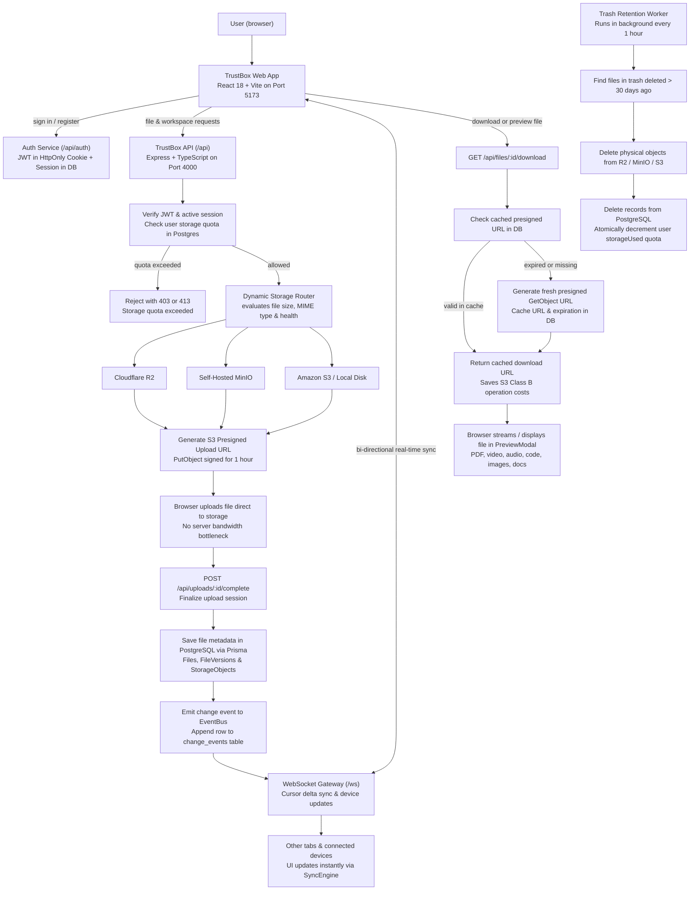

# TrustBox — Storage-Agnostic Google Drive Clone

**TrustBox** is a self-hostable, storage-agnostic cloud file manager and sharing platform engineered around **SOLID Design Principles**, **Prisma ORM**, a pluggable **Storage Abstraction Layer**, and cursor-based **real-time synchronization**.

---

## 🌟 Key Features

- **Storage Abstraction Layer (SOLID Principles)**:
  - Supports **Cloudflare R2**, **MinIO**, **Amazon S3**, and **Local Disk** transparently.
  - Storage providers inherit from an abstract `StorageProvider` interface (`LSP`, `DIP`, `OCP`).
  - Dynamic **Storage Router** routes uploads based on file size, capacity, priority, and health metrics.
- **Logical File Architecture**:
  - Clear domain separation: `Logical File` -> `File Version` -> `Storage Object` -> `Storage Location`.
- **Real-Time Synchronization Engine**:
  - Durable PostgreSQL `change_events` log table paired with Redis / In-Memory PubSub.
  - Resilient cursor-based sync API (`GET /api/sync?cursor=...`) for automatic client recovery upon reconnect.
- **Sharing Capabilities**:
  - Public links with optional passwords and expiration.
  - Restricted email address member permissions (Viewer / Editor).
- **Admin Storage Management**:
  - Monitor health, capacity, and set drain mode on individual storage locations.

---

## 🏛️ Project Architecture



### Architectural Breakdown

#### 1. Client Presentation Tier (`frontend/src`)
- **UI & Interaction Layer**: Component tree built with React 18, Vite, and Tailwind CSS. Organizes views into dedicated feature domains (`files`, `photos`, `sharing`, `workspaces`, `storage`, `auth`, `marketing`).
- **Reactive State Management**: Zustand stores (`fileStore`, `authStore`, `photoStore`, `uploadStore`, `workspaceStore`, `storageStore`) handle optimistic updates, selection queues, multi-file batch actions, and offline/online awareness.
- **Client Sync Engine (`syncEngine.ts`)**: Maintains persistent WebSocket connectivity with exponential backoff reconnection. Automatically resumes synchronization after connection drops using local cursor checkpointing (`localStorage`).

#### 2. API Gateway & Security Layer (`backend/src`)
- **Authentication Middleware (`authMiddleware.ts`)**: Multi-source JWT validation supporting secure HttpOnly cookies, `Authorization: Bearer` headers, and URL token queries. Enforces active database session checks (`UserSession`) to ensure instant session revocation across devices.
- **WebSocket Gateway (`WebSocketGateway.ts`)**: Statefully registers authenticated client sockets, runs periodic heartbeat ping-pong sweeps to clean dead connections, and relays domain events in real-time.
- **Trash Retention Worker (`trashRetentionWorker.ts`)**: Automated background worker that scans for soft-deleted files exceeding the 30-day retention window, purges physical objects from storage backends, and decrements quota transactions atomically.

#### 3. Pluggable Storage Abstraction Layer (SAL)
- **Abstract Provider Interface (`StorageProvider.ts`)**: Implements SOLID design principles (Liskov Substitution & Open-Closed Principles) specifying standard contracts for `upload`, `download`, `delete`, `exists`, `getSignedUploadUrl`, and `getSignedDownloadUrl`.
- **Dynamic Storage Router (`StorageRouter.ts`)**: Evaluates upload routing policies dynamically (e.g., routing large media files > 100 MB to self-hosted MinIO while routing smaller files and documents to Cloudflare R2).
- **Storage Manager (`StorageManager.ts`)**: Singleton registry that tracks location health, presigned download URL database caching (avoiding redundant S3 calls and saving Class B operation costs), and tracks Class A and Class B operations for billing transparency.

#### 4. Event-Driven Delta Synchronization
- **System Event Bus (`EventBus.ts` / `InMemoryEventBus.ts`)**: Dispatches domain events (`file.created`, `file.updated`, `file.deleted`, `folder.created`, etc.) upon mutations.
- **Durable Change Log (`change_events` Table)**: Each modification appends an event row with a monotonically increasing integer sequence ID. Clients request delta updates (`/api/sync?cursor=<id>`), ensuring zero data loss and resilient offline-to-online synchronization.

#### 5. Data & Persistence Model (`schema.prisma`)
- **Decoupled File Model**: Clear separation between Logical File entities (`Files`), Version history (`FileVersions`), Content-addressed Storage Objects (`StorageObjects`), and Physical Storage Locations (`StorageLocations`).
- **Granular RBAC Workspaces**: Workspaces support multi-member collaboration with JSON-based permissions (`permissions Json`) enabling custom roles and access control.
- **Secure Sharing Engine**: `ShareLinks` support password hashing (`bcrypt`), expiration timestamps, and permission levels (`VIEWER`, `EDITOR`).

---

## 🏗 Directory Structure

```
d:/code/imgHosting/
├── backend/                  # Node.js + TypeScript REST & WebSocket API
│   ├── prisma/               # Prisma Schema & Database Migrations
│   └── src/
│       ├── domain/           # SOLID Interfaces, Entities & Abstract Storage Providers
│       ├── infrastructure/   # Prisma DB, Storage Implementations (R2, MinIO, Local), EventBus, WebSockets
│       ├── modules/          # Feature Controllers & Services (Auth, Files, Folders, Uploads, Shares, Sync, StorageAdmin)
│       └── middleware/       # Auth JWT middleware & Error Handlers
│
├── frontend/                 # React + TypeScript Vite Web Client
│   └── src/
│       ├── components/       # Layout, Navigation, UI Elements
│       ├── features/         # FileBrowser, UploadManager, ShareModal, PreviewModal, StorageDashboard
│       ├── services/         # API Client & Real-time Sync Engine
│       └── stores/           # Zustand Stores (FileStore, AuthStore, UploadStore, StorageStore)
│
└── docker-compose.yml        # Orchestration for PostgreSQL, Redis, MinIO, Backend, and Frontend
```

---

## 🚀 Quick Start (Development)

### Prerequisites
- Node.js >= 18.x
- npm / yarn / pnpm
- Docker & Docker Compose (optional for database & MinIO)

### Backend Setup
```bash
cd backend
npm install
npm run prisma:generate
npm run prisma:push
npm run dev
```

### Frontend Setup
```bash
cd frontend
npm install
npm run dev
```

Visit `http://localhost:5173` to access the application.
